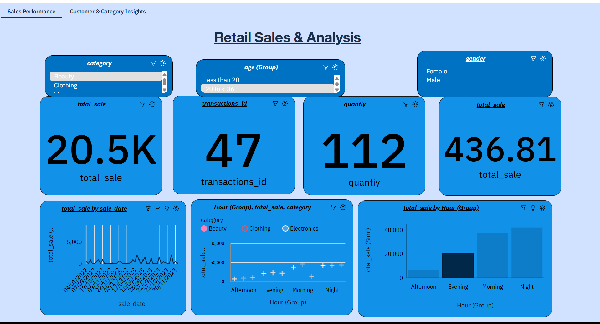
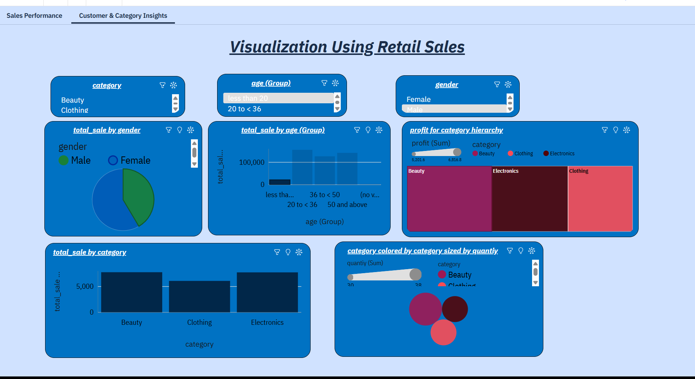

# Retail Sales Analysis Dashboard

An interactive two-page **IBM Cognos Analytics** dashboard built on 2,000 retail transactions (Jan 2022 – Dec 2023). It turns raw sales records into KPIs, trends, and customer-segment views to support product marketing decisions.

**Tools:** IBM Cognos Analytics · SQL · Data Cleaning · Data Visualization

## Dashboard Preview

### Page 1 – Sales Performance

### Page 2 – Customer & Category Insights

## What's Inside

**Sales Performance**
- KPI tiles: total sales, number of transactions, total quantity sold, and average sale
- Sales trend over time (by sale date)
- Sales by time of day (Morning / Afternoon / Evening / Night), split by category

**Customer & Category Insights**
- Sales by gender (pie chart)
- Sales by age group (bar chart)
- Profit by category (treemap)
- Sales by category (bar chart)
- Quantity sold by category (bubble chart)

**Interactive filters (both pages):** category, age group, and gender, for drill-down analysis.

## Dataset

File: [`data/Retail_Sales_Dataset.csv`](data/Retail_Sales_Dataset.csv) – 2,000 transactions, 1 Jan 2022 to 31 Dec 2023.

| Column | Description |
|---|---|
| `transactions_id` | Unique transaction ID |
| `sale_date`, `sale_time` | Date and time of sale |
| `customer_id` | Customer identifier |
| `gender`, `age` | Customer demographics |
| `category` | Beauty, Clothing, or Electronics |
| `quantiy` | Units sold (column name as in the source data) |
| `price_per_unit` | Price per unit |
| `cogs` | Cost of goods sold |
| `total_sale` | Total sale amount |

## Data Preparation

- Handled missing values in the raw data (10 missing ages; 3 rows with missing quantity, price, COGS, and total sale).
- Created calculated fields:
  - **Age group** – bucketed customer ages (less than 20, 20 to < 36, 36 to < 50, 50 and above)
  - **Time-of-day group** – Morning, Afternoon, Evening, Night from the sale time
  - **Profit** – `total_sale − cogs`

## Key Figures (full dataset, unfiltered)

| Metric | Value |
|---|---|
| Total sales | 911,720 |
| Total profit | ≈ 721,957 |
| Sales – Beauty / Clothing / Electronics | 286,840 / 311,070 / 313,810 |

*Computed from rows with a valid `total_sale`. The screenshots above show filtered views, so their tile values differ.*

## How to View

1. Open the screenshots in the `screenshots/` folder for a quick preview.
2. To rebuild the dashboard, upload `data/Retail_Sales_Dataset.csv` to IBM Cognos Analytics and recreate the calculated fields listed above.

## Author

**P Nikhil Pavan** – [LinkedIn](https://www.linkedin.com/in/pnikhilpavan/) · [GitHub](https://github.com/Byte-Nikhil)
